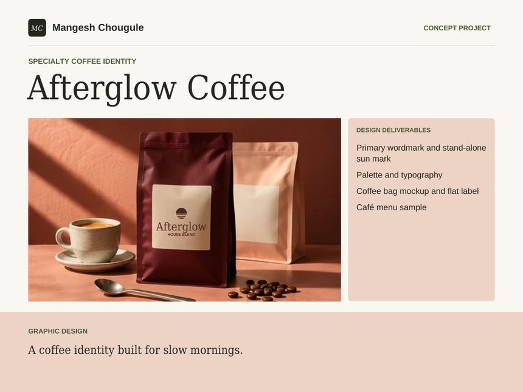

# Afterglow Coffee

**Specialty coffee identity · Concept Project**

[View the interactive case study](https://headless-pyppzbocdia-designtlabz-140b.wix-site-host.com/projects/afterglow-coffee/index.html)

## Brief

Create a specialty coffee identity that feels warm enough for a neighbourhood café and distinct enough to recognize on a retail shelf.

## Audience

Home brewers and café regulars drawn to approachable specialty coffee.

## Design role

Art direction, wordmark and symbol, palette, typography, packaging and menu design.

## Deliverables

- Primary wordmark and stand-alone sun mark
- Palette and typography
- Coffee bag mockup and flat label
- Café menu sample

## Design decisions

- **Build around the rising sun.** A circle and three horizon lines echo the name and create a simple mark that can work at the size of a bag sticker.
- **Create a dependable label order.** The blend title, tasting notes and weight use the same placement so future roasts can join the range.
- **Pair warmth with strong contrast.** Espresso burgundy and peach feel inviting, and a pale menu background keeps prices and item names clearly readable.

## Intended outcome

Build recognition across retail bags and café materials while keeping roast details easy to read.

Project photography and mockup imagery are AI-generated.
