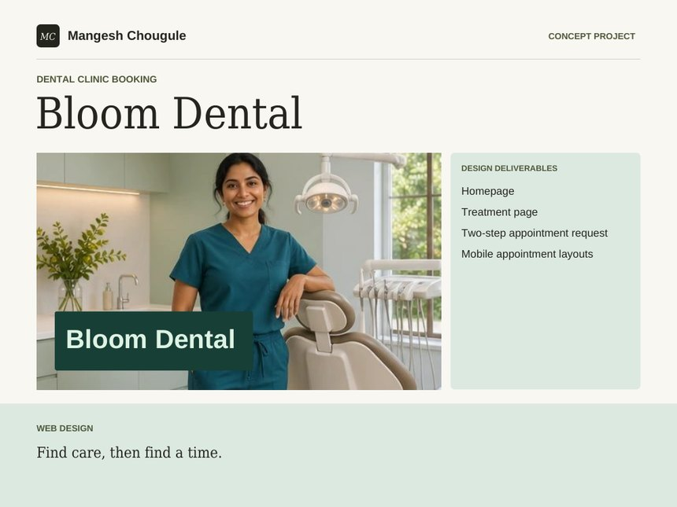

# Bloom Dental

**Dental clinic booking · Concept Project**

[View the interactive case study](https://headless-pyppzbocdia-designtlabz-140b.wix-site-host.com/projects/bloom-dental/index.html)

## Brief

Give a dental practice a welcoming website that helps new patients identify a treatment and work through an appointment request on a phone.

## Audience

New patients comparing treatments and returning patients booking routine visits.

## Design role

Service navigation, responsive visual design, treatment template and appointment flow.

## Deliverables

- Homepage
- Treatment page
- Two-step appointment request
- Mobile appointment layouts

## Design decisions

- **Use patient language.** The homepage names everyday reasons for a visit and the treatment page explains what to expect in plain language.
- **Keep the selected treatment visible.** The booking form opens with the service already filled in, so visitors can see what they are requesting.
- **Split the form at a natural point.** Visit preferences come first, followed by contact information. The review state summarizes both before confirmation.

## Intended outcome

Reduce uncertainty about what happens during a visit and make it easier to request a suitable appointment.

Project photography and mockup imagery are AI-generated.
