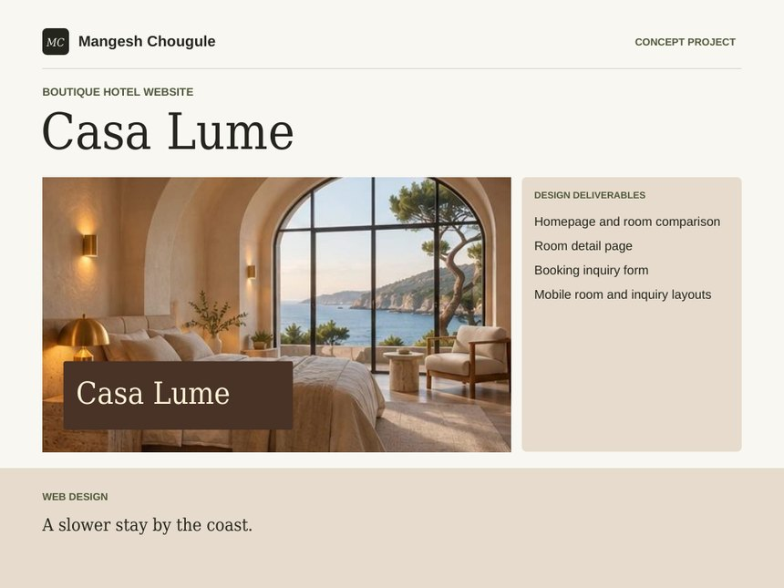

# Casa Lume

**Boutique hotel website · Concept Project**

[View the interactive case study](https://headless-pyppzbocdia-designtlabz-140b.wix-site-host.com/projects/casa-lume/index.html)

## Brief

Design a boutique hotel site that puts room photography first while giving guests clear facts for comparing rooms and sending an inquiry.

## Audience

Couples and small groups planning a short coastal stay.

## Design role

Art direction, room comparison, responsive layouts and booking inquiry design.

## Deliverables

- Homepage and room comparison
- Room detail page
- Booking inquiry form
- Mobile room and inquiry layouts

## Design decisions

- **Give each room an equivalent comparison.** Room cards repeat capacity, size and setting so visitors can compare the two options at a glance.
- **Let photography convey the differences.** The sea-facing suite and garden room use separate photos, while text calls out the view and capacity.
- **Carry the room through to the inquiry.** The form keeps the chosen room visible and asks for dates and party size before contact details.

## Intended outcome

Help guests choose the right room and send the hotel enough information to respond.

Project photography and mockup imagery are AI-generated.
