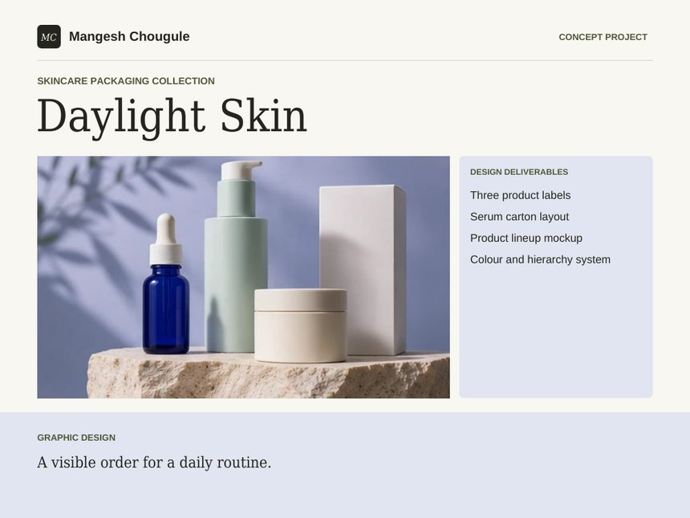

# Daylight Skin

**Skincare packaging collection · Concept Project**

[View the interactive case study](https://mangesh-chougule-design.manco92557768.chatgpt.site/projects/daylight-skin/)

## Brief

Design a three-product skincare collection with a shared front-label hierarchy and a distinct visual cue for each formula.

## Audience

Skincare shoppers looking for a straightforward, everyday routine.

## Design role

Packaging art direction, label system, starter carton and mockup composition.

## Deliverables

- Three product labels
- Serum carton layout
- Product lineup mockup
- Colour and hierarchy system

## Design decisions

- **Repeat the information hierarchy.** The wordmark, routine step, formula name and volume occupy the same positions on all labels.
- **Use two cues to distinguish formulas.** Mint, cobalt and oat separate the range visually. Step numbers and names carry the same distinction when colours are harder to tell apart.
- **Keep the carton consistent with the bottle.** The carton repeats the step number and product name on the front, with application instructions on the side.

## Intended outcome

Make cleanser, serum and moisturiser easy to distinguish on shelf or in a product lineup.

Project photography and mockup imagery are AI-generated.
