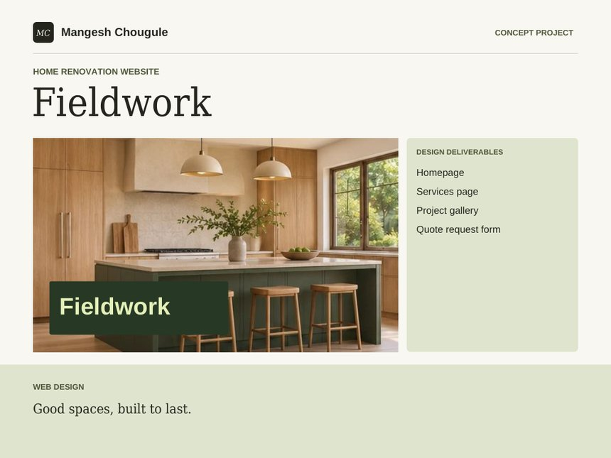

# Fieldwork

**Home renovation website · Concept Project**

[View the interactive case study](https://headless-pyppzbocdia-designtlabz-140b.wix-site-host.com/projects/fieldwork-renovation/index.html)

## Brief

Design a renovation company website that helps homeowners understand service scope, see evidence of design decisions and request a focused quote.

## Audience

Homeowners exploring a kitchen, bathroom or full-home renovation.

## Design role

Art direction, service architecture, gallery layout, responsive quote request design.

## Deliverables

- Homepage
- Services page
- Project gallery
- Quote request form

## Design decisions

- **Place proof near the decision.** A matched before-and-after pair sits above the quote action so visitors see what changed before they reach out.
- **Group services by area of the home.** Kitchen, bath and whole-home cards make project scope easy to understand and point to a relevant next step.
- **Ask only for estimating essentials.** The form gathers the type of renovation, timing and contact details with one optional space for project notes.

## Intended outcome

Help homeowners match their needs to a service and provide enough detail to start a quote discussion.

Project photography and mockup imagery are AI-generated.
