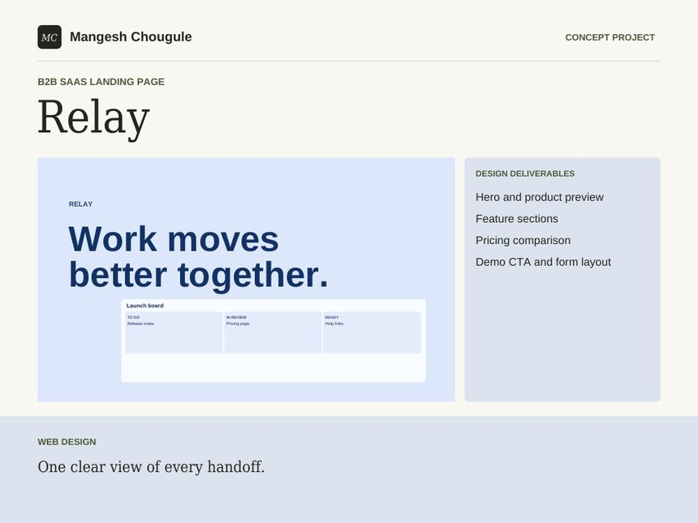

# Relay

**B2B SaaS landing page · Concept Project**

[View the interactive case study](https://headless-pyppzbocdia-designtlabz-140b.wix-site-host.com/projects/relay/index.html)

## Brief

Introduce a workflow handoff tool to B2B visitors who need to understand its purpose quickly before comparing plans or asking for a demo.

## Audience

Operations leads and project managers coordinating work across teams.

## Design role

Landing-page strategy, product UI concept, responsive layout and interface copy.

## Deliverables

- Hero and product preview
- Feature sections
- Pricing comparison
- Demo CTA and form layout

## Design decisions

- **Show a concrete workflow.** A sample launch board uses familiar task names and explicit owners to explain what Relay tracks.
- **Write features around decisions.** Ownership, next actions and history each answer a distinct question a first-time visitor might have.
- **Keep evaluation paths visible.** Pricing and demo buttons connect directly to the relevant sections, with a stacked comparison on mobile.

## Intended outcome

Make the product easy to understand at a glance and give visitors a short path to a demo.

Project photography and mockup imagery are AI-generated.
