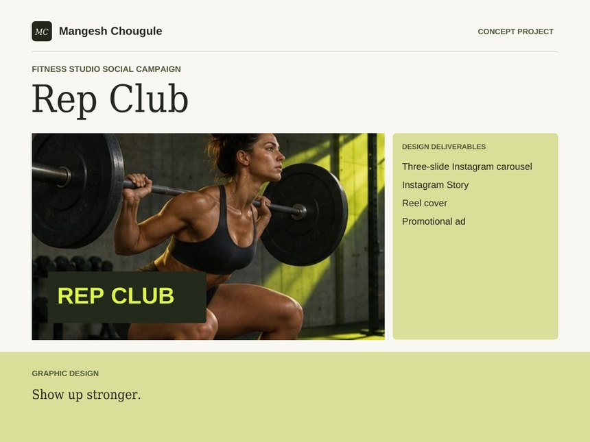

# Rep Club

**Fitness studio social campaign · Concept Project**

[View the interactive case study](https://mangesh-chougule-design.manco92557768.chatgpt.site/projects/rep-club/)

## Brief

Build a short launch campaign for a strength studio that works across feed, Story, Reel and paid placements.

## Audience

People looking to start or return to coached strength training.

## Design role

Campaign concept, copy hierarchy, photo art direction and social layouts.

## Deliverables

- Three-slide Instagram carousel
- Instagram Story
- Reel cover
- Promotional ad

## Design decisions

- **Give each placement one main message.** The carousel sequences the idea, class format and action. The Story goes straight to the trial offer.
- **Use a recognizable headline treatment.** Lime, condensed uppercase type and a consistent photo grade tie the placements together.
- **Design for the crop.** The tall Story and Reel use a central text zone. The ad makes room for a readable CTA beside the photo.

## Intended outcome

Make the introductory strength offer recognizable across formats and put the booking action in reach.

Project photography and mockup imagery are AI-generated.
