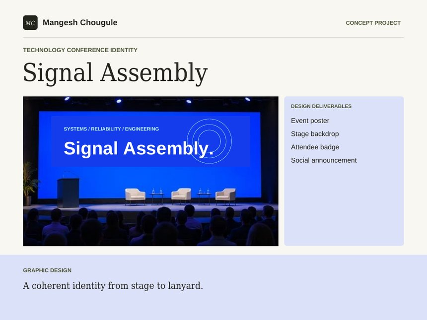

# Signal Assembly

**Technology conference identity · Concept Project**

[View the interactive case study](https://headless-pyppzbocdia-designtlabz-140b.wix-site-host.com/projects/signal-assembly/index.html)

## Brief

Design an event identity for a one-day technology conference on building software that stays dependable as it grows.

## Audience

Software builders, engineering leads and hands-on technical founders.

## Design role

Event art direction, visual system, poster, stage screen, badge and social design.

## Deliverables

- Event poster
- Stage backdrop
- Attendee badge
- Social announcement

## Design decisions

- **Build the identity around signal rings.** A repeated ring graphic frames the typography and can be cropped differently while retaining the same character.
- **Change hierarchy by viewing distance.** The stage keeps only the event title and theme. The badge gives the attendee name the largest type.
- **Use contrast to carry the small formats.** White on deep blue and dark type on pale aqua keep agenda information and badge details distinct.

## Intended outcome

Make the event recognizable across touchpoints and keep the essential information readable at each scale.

Project photography and mockup imagery are AI-generated.
