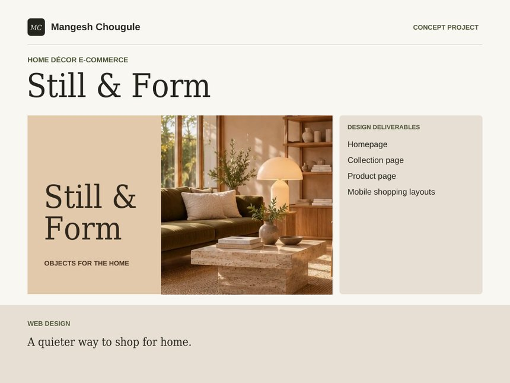

# Still & Form

**Home décor e-commerce · Concept Project**

[View the interactive case study](https://headless-pyppzbocdia-designtlabz-140b.wix-site-host.com/projects/still-and-form/index.html)

## Brief

Design an online home décor shop that takes shoppers from an editorial room scene to a collection and then a product they can evaluate with confidence.

## Audience

Design-conscious shoppers furnishing a home one piece at a time.

## Design role

Art direction, shopping journey, responsive interface and product presentation.

## Deliverables

- Homepage
- Collection page
- Product page
- Mobile shopping layouts

## Design decisions

- **Let the room tell the story.** The homepage leads with a furnished room and points straight to the living collection so shoppers can connect the mood to something they can browse.
- **Make the collection easy to scan.** Consistent image ratios, prices and short material labels make lighting, seating and objects easier to compare.
- **Surface details at the decision point.** The product page groups the finish, dimensions and delivery information beside the primary action, then stacks the same details on mobile.

## Intended outcome

Help shoppers discover pieces by room and make a decision with clear dimensions, materials and delivery information.

Project photography and mockup imagery are AI-generated.
