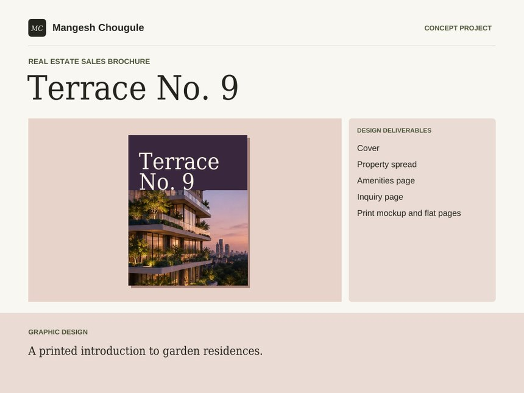

# Terrace No. 9

**Real estate sales brochure · Concept Project**

[View the interactive case study](https://headless-pyppzbocdia-designtlabz-140b.wix-site-host.com/projects/terrace-no-nine/index.html)

## Brief

Design a property brochure that introduces a residential concept through architecture, everyday amenities and a clear invitation to inquire.

## Audience

Prospective buyers comparing urban homes and planning a visit.

## Design role

Art direction, brochure grid, print typography and property storytelling.

## Deliverables

- Cover
- Property spread
- Amenities page
- Inquiry page
- Print mockup and flat pages

## Design decisions

- **Open with a single architectural image.** The dusk photo establishes the setting and gives the restrained cover type room to breathe.
- **Keep details on a repeatable print grid.** The property spread uses one image-led page and one editorial text page, with consistent margins across the brochure.
- **Make the inquiry card easy to find.** The final page groups viewing preferences and follow-up details in a visually distinct panel.

## Intended outcome

Help a reader picture the property and find the inquiry information after browsing the brochure.

Project photography and mockup imagery are AI-generated.
